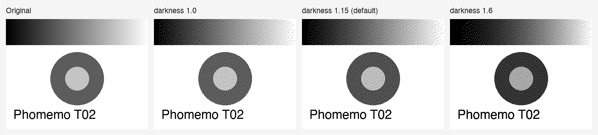

# T02 SDK

Print your own images on a **Phomemo T02** thermal printer over Bluetooth LE, without the Phomemo app.
One Python file (`t02.py`), built on `bleak` and `pillow`. The BLE protocol is documented below, so you can port it to Swift, Kotlin or Flutter.

> Unofficial. Not affiliated with Phomemo. The protocol was observed on one T02 and cross-checked against [kchromik/phomemo-t02-flutter](https://github.com/kchromik/phomemo-t02-flutter).



## Quick start

```bash
python3 -m venv .venv && .venv/bin/pip install -r requirements.txt
.venv/bin/python t02.py              # prints a small test label
.venv/bin/python t02.py photo.png    # prints an image
```

Quit the Phomemo app first. The printer accepts only one BLE connection, and while the app holds it the T02 does not show up in scans.

```python
import asyncio
from PIL import Image
from t02 import T02

async def main():
    async with T02() as printer:
        ok = await printer.print_image(Image.open("photo.png"), darkness=1.3, autocontrast=True)
        print("done" if ok else "no completion report", printer.status)

asyncio.run(main())
```

On macOS the first run asks for Bluetooth permission for your terminal.

## Preparing images

The printer is 384 dots wide (203 DPI), one bit per dot. The SDK flattens transparency onto white, scales to 384 px width, dithers (Floyd-Steinberg) and sends the rows.

| Option | Effect |
| --- | --- |
| `darkness` | Software gamma. Above 1 prints darker, below 1 lighter. Default 1.0. |
| `autocontrast` | Stretches the tonal range first. Helps flat photos. |
| `feed` | Paper feed after the job (`1B 64 n`), default 4. |



The images above are rendered from the SDK's own raster output (black = printed dot).
`darkness` is a software setting. A hardware density command for the T02 was not found (see below).

HEIC photos: convert first, for example `sips -s format png IMG.HEIC --out IMG.png` on macOS.

## Protocol

All bytes below were checked against a T02, except where noted.

| Item | Value |
| --- | --- |
| Service | `0000FF00-0000-1000-8000-00805F9B34FB` |
| Write (without response) | `FF02` |
| Notify | `FF03` |
| Read | `FF01` (unused) |

**Session**
1. Connect, subscribe to notifications on `FF03`.
2. Send the init queries `1F 11 xx` with xx = `7B 20 45 0E 07 5E 08 09 38 8B 63`. The printer answers with its status: packet limit, MAC, serial and more.
3. Send the job in chunks no larger than the packet limit (the T02 reported 182 bytes).
4. Wait for `01 n` credits from the printer before further writes. The T02 returns one credit per write.
5. `1A 0F 0C` means the job finished.

**Notifications**

| Bytes | Meaning |
| --- | --- |
| `01 n` | n more writes allowed |
| `02 n 00` | packet limit n |
| `1A 0F 0C` | print done |
| `1A 03 A9` / `1A 03 A8` | too hot / temperature normal (from the Flutter repo) |
| `1A 05 99` / `1A 05 98` | cover open / closed (from the Flutter repo) |
| `1A 06 88` / `1A 06 89` | paper missing / present (from the Flutter repo) |
| `1A 0B B8` | job cancelled (from the Flutter repo) |

**Job**

```
1B 40               reset
1B 61 01            center
1F 11 35 00         uncompressed raster mode
1D 76 30 00 30 00 <h lo> <h hi>    raster block, then 48 bytes per row
1B 64 n             feed
```

Rows go top to bottom, 48 bytes each, the most significant bit is the leftmost dot, 1 is black.
Send the whole image as **one** block (height is 16 bit). Splitting into 255-row blocks, as the Flutter repo does, produced double lines at every seam on this T02. One block of 700 rows printed cleanly; much longer images were not tested.

## License

MIT, see [LICENSE](LICENSE).
